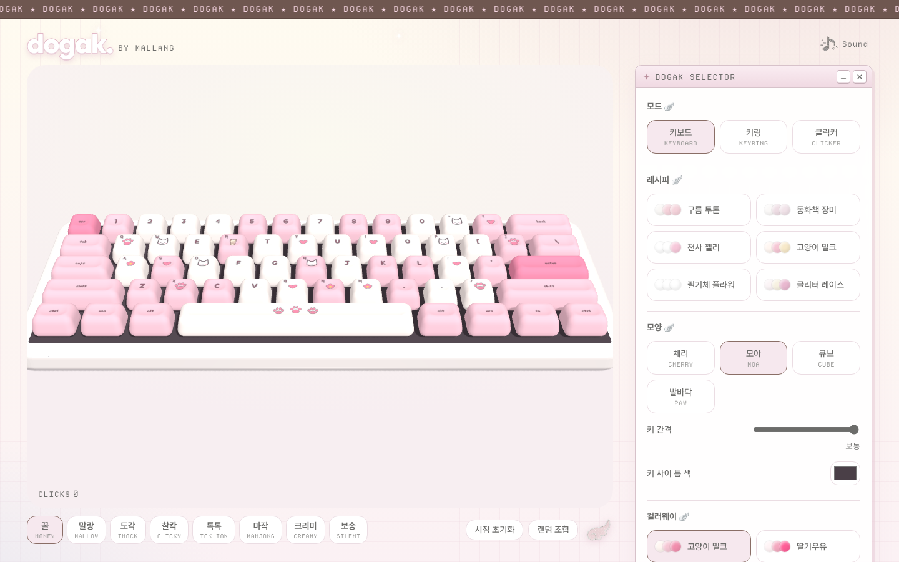
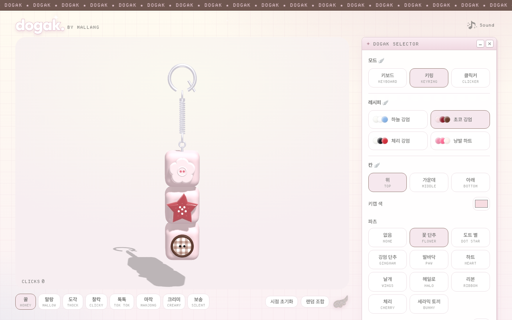
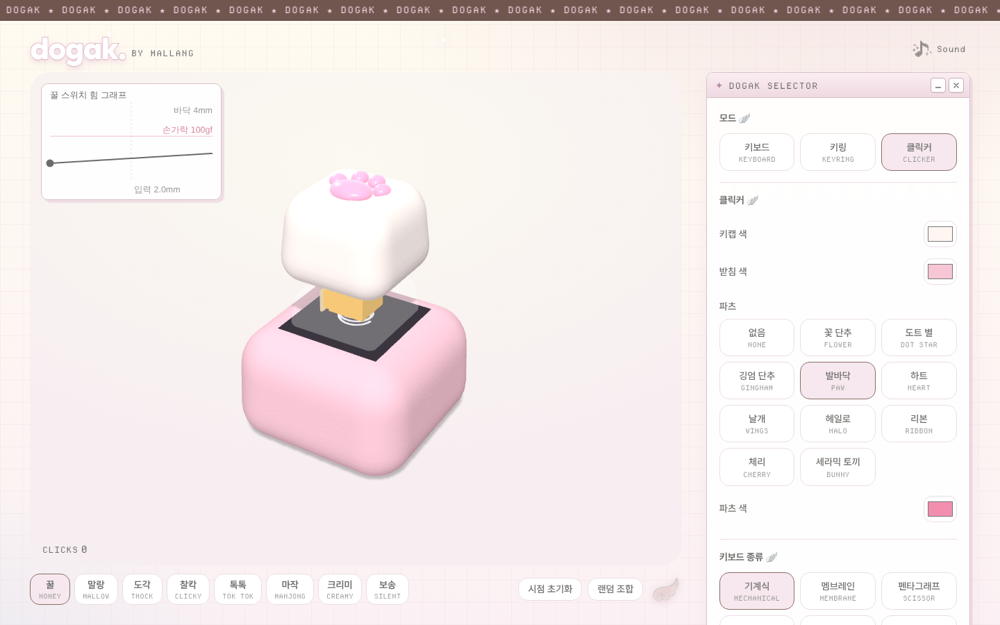

# dogak.

**도각도각, 손끝으로 듣는 키캡 ASMR**

[**dogak.studio**](https://dogak.studio) 에서 바로 눌러 보세요 · by [mallang.](https://mallang.studio)

## 이런 곳이에요

dogak.은 브라우저에서 키캡을 누르고, 돌려 보고, 꾸밀 수 있는 키캡 ASMR 사이트예요.
이어폰을 끼고 키보드를 치면 마이크를 키캡 바로 앞에 댄 것처럼 가까운 소리가 들려요.

- **사운드 8가지:** 꿀 · 말랑 · 도각 · 찰칵 · 톡톡 · 마작 · 크리미 · 보송
- **모드 3가지:** 키보드 · 키링 · 클릭커
- **360° 회전:** 드래그로 돌려 보고, 확대해서 볼 수 있어요
- **커스텀:** 레시피(색 조합), 키캡 모양, 키 간격, 틈 색, 파츠(꽃 단추·하트·리본…)
- **스위치 힘 그래프:** 누르는 깊이에 따라 손가락 힘이 어떻게 바뀌는지 보여줘요

| 키링 | 클릭커 |
|:---:|:---:|
|  |  |

## 소리는 어떻게 만들었나요

녹음 파일을 재생하는 대신, 실제 스위치가 눌리는 과정(걸림 · 클릭 · 바닥 · 복귀)을 계산해서
그 순간마다 소리를 실시간으로 만들어요. 그래서 누를 때마다 미세하게 다른 소리가 나요.

## 메뉴 막대 친구 · dogak. counter

Mac 메뉴 막대에서 오늘 친 키 횟수를 세 주는 작은 앱도 있어요.
빠르게 칠수록 키캡 캐릭터가 더 빨리 도각도각 움직여요.
어떤 키를 눌렀는지는 저장하지 않고, 날짜별 횟수만 맥 안에 남겨요.

## 만든 기술

`three.js` · `Web Audio API` · `Swift (AppKit)`

---

마음에 들면 ⭐ 하나 눌러 주세요. 도각이가 기뻐해요.

이 저장소는 소개용이에요. 소스 코드는 공개하지 않아요.

© 2026 dogak. All rights reserved.

